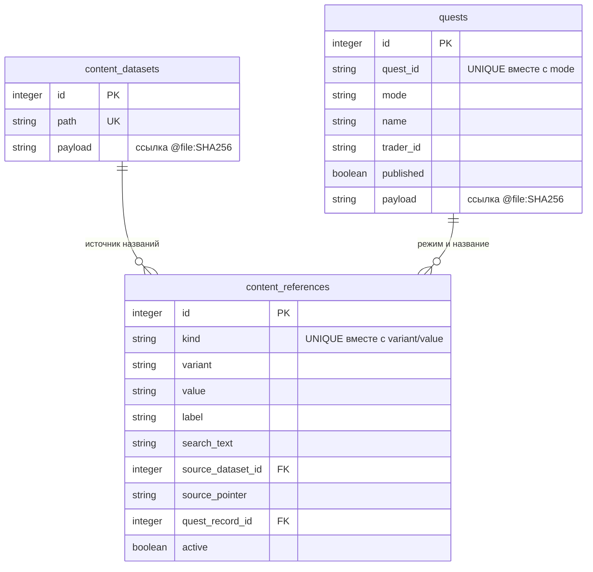

# Связи контента на Laravel, Orchid и SQLite

## Решение, применённое в этом релизе

Laravel 13 и Eloquent управляют HTTP, валидацией, транзакциями и миграциями; Orchid —
формами. SQLite остаётся на alwaysdata. В соответствии с требованием редактора JSON
квестов и справочников хранится только в неизменяемых файлах. SQLite теперь также
содержит предметные таблицы с FK: квесты, цели, предметы, ключи, точки, карты, этажи,
группы условий и награды. ID квестов и целей сохраняются для личного прогресса,
новые создаются сервером. Orchid выбирает строки по названию; Laravel проверяет
тип, режим, версию, координаты, циклы и revision. Предметная строка и ссылки на
совместимые файлы изменяются в одной SQLite-транзакции; старые файлы не удаляются.

Просмотрены [документы на Маяке](https://tarkov-compass.narnesss.workers.dev/documents/lighthouse)
и [карта Tarkov Market](https://tarkov-market.com/maps/lighthouse) 15 октября 2026.
Первый пример требует категорий документов, подписей, фотографий, альтернативных
позиций и личных отметок. Второй — этажей, типов выхода, целей квестов, спавна ключа
и места его использования, фильтров и поиска. Количество точек из исходного задания
не принимается за ограничение или подтверждённый игровой факт. Примеры наград/ключей
из приложенного текста не используются как новые сиды без проверки источника.

## Совместимый индекс файлов



Совместимый индекс названий создаёт Laravel migration
`2026_10_15_000003_create_content_references.php`; он использует только обычные SQLite
колонки. PK, FK, UNIQUE, NOT NULL, DEFAULT и индексы перечислены в database-map.md.
`label/search_text` — намеренная денормализация производного индекса; его можно
восстановить из файлов командой `wiki:reference-index`. Поэтому выдавать эту схему
за полностью нормализованный игровой граф было бы неверно.

Режимы квестов разделены в индексе; общие предметы/торговцы имеют единый вариант
default, локации — варианты game и slug, этажи — slug своей карты. FK на файл
связывает имя с авторитетным источником. `source_pointer` указывает на запись внутри
файла, не содержит JSON и не предлагается редактору для ввода. Неизвестная прежняя
ссылка сохраняется, но новая связь обязательно выбирается из активного справочника.

## Реализованная предметная модель

Миграция `2026_10_15_000004_create_wiki_domain.php` применяет базовый DDL из
`database/migrations/sql/2026_10_15_domain.sql` и добавляет служебные колонки,
происхождение файлов и отдельные мировые позиции. Сохраняются прежние API и
файловые поля, не описанные в предметной модели. Реализованы сущности и связи:

- Локация 1:N изображений карты; карта 1:N этажей. Изображение хранит URL, положительные
  width/height и версию. Игровой ID и slug — разные уникальные ключи.
- Точка принадлежит одной локации, имеет заголовок, описание, стабильный внешний ID,
  порядок и признак активности. Точка 1:N позиций: карта, этаж, x/y в процентах,
  optional мировые x/y/z отдельно. Это поддерживает x2/y2 без специальной второй пары
  колонок. Разные реальные спавны — разные точки, не изображения одной позиции.
- Документы M:N точки через point_documents. Предметы M:N точки через item_spawns
  с вероятностью nullable, количеством и примечанием. Неизвестная вероятность не равна нулю.
- Ключ — специализация предмета 1:0..1 (PK одновременно FK item_id), без дублирования
  названия. key_usages связывает ключ M:N с точками дверей/контейнеров, имеет способ
  доступа, optional и примечание. Спавн ключа использует item_spawns.
- Выход — специализация точки 1:0..1, тип/фракция, текст требований, nullable стоимость
  в рублях. Точка M:N категорий: одна точка может одновременно быть местом квеста,
  спавном и местом использования ключа; один enum type этого не выражает.
- Торговец 1:N квестов. Квест 1:N целей. Цель M:N предметов (количество, FIR),
  локаций, точек и ключей (обязательность). Навыки и модули убежища — отдельные
  справочники, требования к ним — типизированные таблицы-связки.
- Условия открытия квеста — группы AND/OR и их вложенность, рёбра к предшествующим
  квестам со статусом и жёсткостью. При записи проверяется отсутствие циклов и совпадение
  режима/версии; SQL FK сам по себе не предотвращает цикл.
- Награды: набор start/finish, предметы с количеством, репутация торговцев, навыки,
  открытия торговцев/крафтов/предложений/локаций. Составные награды не помещаются в
  одну строку текста или JSON-колонку. Крафты/предложения ссылаются на предметы и торговцев.
- Медиа 1:N привязок к точке/цели/квесту; URL, подпись, автор/источник, порядок.
  Личный прогресс остаётся в существующем закрытом хранилище и не входит в общий кэш.

Для предметной модели выбираем отдельные таблицы-связки с FK. Универсальная
`point_relations(type,id)` лишает SQLite возможности проверить существование цели.
Текущий content_references — поисковая проекция, а не замена предметных FK.

```mermaid
erDiagram
    locations ||--o{ maps : images
    maps ||--o{ map_layers : floors
    locations ||--o{ map_points : contains
    map_points ||--o{ point_positions : positions
    maps ||--o{ point_positions : image
    map_layers o|--o{ point_positions : floor
    map_points ||--o{ point_category_links : roles
    point_categories ||--o{ point_category_links : type
    documents ||--o{ point_documents : document
    map_points ||--o{ point_documents : spawn
    items ||--o{ item_spawns : item
    map_points ||--o{ item_spawns : spawn
    items ||--o| keys : specialization
    keys ||--o{ key_usages : key
    map_points ||--o{ key_usages : door
    map_points ||--o| extractions : specialization
    traders o|--o{ quests : giver
    quests ||--o{ objectives : ordered
    objectives ||--o{ objective_groups : conditions
    objective_groups o|--o{ objective_groups : nested
    objective_groups ||--o{ objective_items : conditions
    items ||--o{ objective_items : required
    objectives ||--o{ objective_locations : locations
    locations ||--o{ objective_locations : location
    objectives ||--o{ objective_points : markers
    map_points ||--o{ objective_points : point
    objectives ||--o{ objective_keys : access
    keys ||--o{ objective_keys : key
    quests ||--o{ prerequisite_groups : conditions
    prerequisite_groups o|--o{ prerequisite_groups : nested
    prerequisite_groups ||--o{ quest_prerequisites : edges
    quests ||--o{ quest_prerequisites : predecessor
    quests ||--o{ quest_trader_requirements : loyalty
    traders ||--o{ quest_trader_requirements : trader
    quests ||--o{ reward_sets : timing
    reward_sets ||--o{ reward_items : items
    items ||--o{ reward_items : reward
    reward_sets ||--o{ reward_standing : reputation
    traders ||--o{ reward_standing : trader
    reward_sets ||--o{ reward_skills : skills
    skills ||--o{ reward_skills : skill
    reward_sets ||--o{ reward_unlocks : unlocks
    traders o|--o{ reward_unlocks : trader
    crafts o|--o{ reward_unlocks : craft
    offers o|--o{ reward_unlocks : offer
    locations o|--o{ reward_unlocks : location
    achievements o|--o{ reward_unlocks : achievement
    stations ||--o{ crafts : station
    items ||--o{ crafts : product
    crafts ||--o{ craft_ingredients : ingredients
    items ||--o{ craft_ingredients : item
    traders ||--o{ offers : seller
    items ||--o{ offers : item
    quests ||--o{ quest_skill_requirements : requirements
    skills ||--o{ quest_skill_requirements : skill
    quests ||--o{ quest_station_requirements : requirements
    stations ||--o{ quest_station_requirements : station
    media ||--o{ media_links : attachments
    map_points o|--o{ media_links : point
    quests o|--o{ media_links : quest
    objectives o|--o{ media_links : objective
    versions ||--o{ quests : snapshot
    versions ||--o{ maps : snapshot
    items ||--o{ item_translations : language
    map_points ||--o{ point_translations : language
    quests ||--o{ quest_translations : language
```



Исполняемый пример DDL под SQLite:
[content-domain.sqlite.sql](content-domain.sqlite.sql). Это базовый DDL применённой миграции;
добавочные служебные поля и мировые позиции описаны в самой Laravel migration.
Названия с префиксом wiki_ исключают
конфликт с действующей таблицей quests. ON DELETE без явного действия означает
штатный SQLite NO ACTION; не включать очистку авторитетных сущностей через CASCADE.
Для translations приведён одинаковый шаблон трёх наиболее крупных каталогов;
локализация остальных сущностей добавляется такими же таблицами с конкретным FK.

## Ограничения и индексы проекций

Для всех справочников — integer PK, стабильный external_id UNIQUE NOT NULL, name
NOT NULL, active DEFAULT 1 CHECK IN (0,1). Для режима CHECK IN ('pve','regular').
Для версии данных — FK, внешние ключи уникальны в пределах режима и версии, а ID
сущности прогресса остаётся стабильным между версиями. Составные PK таблиц связей
включают роль/группу, если один предмет имеет несколько разных назначений.

FK связей обязательны; удаление редакторских сущностей заменяется archived/active,
CAS защищает от устаревшей формы. CASCADE допустим для производных проекций и
зависимых строк, RESTRICT — для авторитетных справочников с живыми связями.
Количество > 0, уровень >= 0, стоимость >= 0, вероятность BETWEEN 0 AND 1 либо NULL,
проценты BETWEEN 0 AND 100, размер изображения > 0. Этаж должен принадлежать выбранной
карте, карта и точка — одной локации: это проверяют составные FK и серверная валидация.
Пустой этаж отличается от первого этажа. Названия и переводы не являются PK.

Индексы: points(location_id,active), point_categories(category,point_id),
positions(map_id,layer_id,point_id), обе стороны каждой M:N, objectives(quest_id,order_index),
prerequisites(prerequisite_quest_id,quest_id), item_spawns(item_id,point_id),
key_usages(key_item_id,point_id). Не дублировать индекс, уже покрытый составным PK.
Нормализованный в PHP search_text нужен из-за ASCII-ограничений SQLite lower/NOCASE.
При большом каталоге — FTS5 с проверкой доступности расширения; текущий bounded instr
по типу и варианту достаточен для нескольких тысяч названий.

## Запросы, выполняемые сейчас

```sql
-- Поиск Orchid: :q предварительно приведён к нижнему регистру Unicode в PHP.
SELECT id, label FROM content_references
WHERE kind = :kind AND variant = :variant AND active = 1
  AND instr(search_text, :q) > 0
ORDER BY label LIMIT 20;

-- Проверка выбранной записи перед сохранением.
SELECT value, source_dataset_id, source_pointer FROM content_references
WHERE id = :selected_id AND kind = :kind AND variant = :variant AND active = 1;

-- Обратное открытие авторитетной карточки.
SELECT q.id, q.quest_id, q.mode, q.payload FROM quests q
JOIN content_references r ON r.quest_record_id = q.id
WHERE r.id = :selected_id AND r.kind = 'quest';
```

Прежний API читает файл по SHA. Новый `WikiGraph` читает SQLite напрямую:
`/api/content/data/wiki/points.json?location=lighthouse&mode=pve&q=...&category=...`,
`wiki/items.json`, `wiki/keys.json`, `wiki/locations.json`, `wiki/quests.json`.
Списки выдаются по 50 строк; детали — `wiki/points/<id>.json` и `wiki/quests/<id>.json`.
Детали точки включают документы, спавны, ключи, опубликованные квесты и медиа;
детали квеста — цели, деревья И/ИЛИ и типизированные награды. Все ответы private/no-store,
на origin действует прежний VerifyApiProxy. Пример recursive CTE ниже остаётся примером
для будущего UI цепочек; вычисление доступности и перевод всего публичного UI на граф
в эту задачу не входят.

```sql
-- Пример после внедрения типизированных проекций: точки локации с фильтром и поиском.
SELECT p.* FROM wiki_map_points p JOIN wiki_locations l ON l.id=p.location_id
WHERE l.slug=:slug AND p.active=1 AND instr(p.search_text,:q)>0
  AND (:category IS NULL OR EXISTS (
    SELECT 1 FROM wiki_point_category_links c WHERE c.point_id=p.id AND c.category=:category))
ORDER BY p.id LIMIT :limit OFFSET :offset;

-- Детали точки: разные роли возвращаются без декартова произведения связей.
SELECT 'document' AS role,d.external_id AS external_id,d.name AS name
FROM wiki_point_documents x JOIN wiki_documents d ON d.id=x.document_id WHERE x.point_id=:point
UNION ALL
SELECT 'item_spawn',i.external_id,i.name FROM wiki_item_spawns x JOIN wiki_items i ON i.id=x.item_id WHERE x.point_id=:point
UNION ALL
SELECT 'key_usage',i.external_id,i.name FROM wiki_key_usages x JOIN wiki_items i ON i.id=x.key_item_id WHERE x.point_id=:point
UNION ALL
SELECT 'quest',q.external_id,q.title FROM wiki_objective_points x JOIN wiki_objectives o ON o.id=x.objective_id
JOIN wiki_quests q ON q.id=o.quest_id WHERE x.point_id=:point AND q.mode=:mode AND q.version_id=:version;

-- Цели с предметами. Сначала Laravel загружает квест, затем эти строки и другие связи.
SELECT o.external_id,o.description,o.order_index,g.id AS group_id,g.parent_id,g.operator,
       i.external_id AS item_external_id,i.name,x.amount,x.found_in_raid,x.role
FROM wiki_objectives o LEFT JOIN wiki_objective_groups g ON g.objective_id=o.id
LEFT JOIN wiki_objective_items x ON x.group_id=g.id LEFT JOIN wiki_items i ON i.id=x.item_id
WHERE o.quest_id=:quest ORDER BY o.order_index,g.order_index;
SELECT o.external_id,l.slug,l.name FROM wiki_objectives o
JOIN wiki_objective_locations x ON x.objective_id=o.id JOIN wiki_locations l ON l.id=x.location_id WHERE o.quest_id=:quest;
SELECT o.external_id,i.name,x.optional FROM wiki_objectives o JOIN wiki_objective_keys x ON x.objective_id=o.id
JOIN wiki_items i ON i.id=x.key_item_id WHERE o.quest_id=:quest;
SELECT o.external_id,p.external_id,p.title FROM wiki_objectives o JOIN wiki_objective_points x ON x.objective_id=o.id
JOIN wiki_map_points p ON p.id=x.point_id WHERE o.quest_id=:quest;

-- Все зависимые квесты, которые потенциально откроются после выбранного.
WITH RECURSIVE following(id) AS (
    SELECT :quest
    UNION
    SELECT g.quest_id FROM following f
    JOIN wiki_quest_prerequisites p ON p.prerequisite_quest_id=f.id
    JOIN wiki_prerequisite_groups g ON g.id=p.group_id
    JOIN wiki_quests q ON q.id=g.quest_id WHERE q.mode=:mode AND q.version_id=:version
)
SELECT q.* FROM following f JOIN wiki_quests q ON q.id=f.id WHERE q.id<>:quest;
```

Названия зависят только от своей сущности; связи содержат только FK и атрибуты связи:
эта предметная часть соответствует 3НФ. Колонка location_id в positions дублирует
принадлежность карты/точки ради составных FK и предотвращения разных локаций.
search_text — ещё одна обоснованная производная денормализация. Инварианты дерева,
совпадение режима/версии зависимых квестов и точное значение координат требуют
валидации Laravel; декларативные FK/CHECK проверяют только выраженные в DDL ограничения.

## Миграция, версии и языки

Первичный `wiki:import-content` переносит существующие наборы/квесты, сохраняя ID;
повтор не меняет правки редактора. `wiki:content-files --move` переносит прежние значения
в неизменяемые файлы. Затем `wiki:reference-index` собирает имена и происхождение.
`wiki:import-domain` выполняет идемпотентный backfill предметных таблиц; файлы при
импорте не меняются. Команда включена в deploy после переноса файлов. Новые формы
сохраняют SQLite и совместимые файлы; прежние формы синхронизируют проекцию через
WikiSync. Неизвестные ссылки получают текстовый отчёт wiki_import_issues и остаются
в исходном файле. Изменённые деревья И/ИЛИ сериализуются только в файлы и сохраняют
свои source_path при повторном импорте. Это техническое происхождение, скрытое в UI.

Всё, что редактор заполняет, остаётся текстовыми, числовыми, логическими полями и
выбором связанных записей. JSONB и ручных JSON-форм нет; в SQLite не добавляется
контент JSON. Для этой задачи не используются PostgreSQL, Prisma или Drizzle.

Хранить мировые координаты отдельно от процентов изображения: одна калибровка не
подходит всем этажам/изображениям. Новая картинка создаёт версию карты, не молча меняет
координаты старых точек. Вайп, патч и режим — отдельные измерения: вайп сбрасывает
личное состояние по явной политике, патч создаёт версию контента, а не новые ID прогресса.
Удалённые квесты архивируются; новая структура целей требует явного соответствия старых
ID новым и миграции прогресса. SHA файлов обеспечивает техническую историю, но не
заменяет редакторский журнал патчей/авторства.

Для ru/en/ja нужны отдельные таблицы переводов с FK на конкретную сущность и
UNIQUE(entity_id,locale), fallback ru → en, отдельные search_text на язык. Полиморфную
translation(entity_type,entity_id) без FK лучше не вводить. Сейчас источники содержат
русские имена и английские aliases; полноценная японская локализация не заявляется.

Нагрузка низкая: WAL, короткие транзакции, busy_timeout, подготовка сжатого файла
перед сменой ссылки. Бэкап должен включать согласованный SQLite-снимок и весь каталог
content; перенос одного SQLite-файла теряет тексты. С предметным графом полный локальный
каталог занимает около 88 МиБ; бюджет 100 МиБ сохраняет одну полную копию. Секреты, сессии и личные
отметки никогда не помещаются в публичную проекцию или экспорт Cloudflare.
